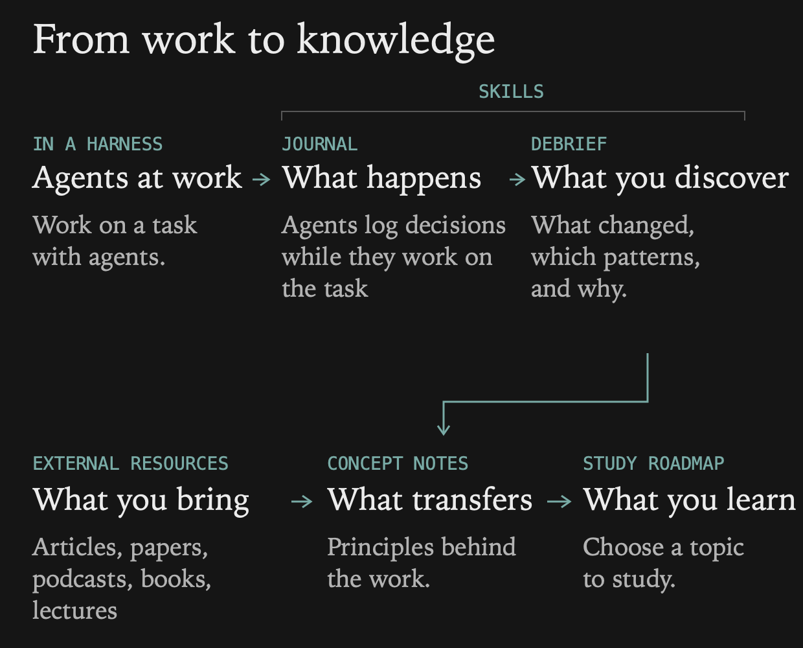

# Work to Knowledge — reviewable draft

A portable agent skill for keeping decision history and learning from substantive work. Plain Markdown works in any editor; Obsidian is optional.

Python 3 is optional for the read-only scope/checkpoint planning helper and required for the included tests. There are no dependencies, scheduler, network client, or automatic installer.

## Compatibility

Setup adapters are documented for **Codex, Claude Code, Pi, and Cursor**. They have not been live-tested with this package. Codex, Claude Code, and Pi use their documented skill/instruction loading; the Cursor adapter uses persistent rules that point to the package. See the [harness guide](references/harnesses.md) before setup.

This package does not provide or claim a generic ChatGPT local `SKILL.md` installation. Other environments need their own verified file access and instruction-loading integration. It is an agent-guided workflow, not a background service.

## Install and set up later

This folder is a draft, not installed or activated. Review `SKILL.md`, then ask your agent:

> Read this package's SKILL.md and run its one-time guided setup. Show me the exact scope, storage, approved source folders, roadmap mode, and permanent instruction changes. Use my choices to configure it without changing unrelated setup.

[Setup](references/setup.md) explains configuration, permission boundaries, harness destinations, and rollback. The setup agent can create the selected folders and templates, save a validated config, and insert a small marked instruction block in the selected harness. Do not install the sample config unchanged; it is deliberately disabled. No global install is implied. Select global, one project, or selected workspaces/topics with exclusions. Once configured, recording does not ask at each session.

Use “no record this session” for a temporary override, “exclude this project from work-to-knowledge,” “change learning objective,” or “disable work-to-knowledge” for persistent changes. Ask for “show work-to-knowledge config” to inspect the exact persisted settings. The config is re-read before writes; changed harness instructions may require a new session.

## What runs, and when

The agent evaluates the loop while handling work, after each meaningful journal update, at an observed handoff/milestone, and when explicitly asked to catch up on an approved journal. A PR can be a milestone but is optional. The skill cannot observe an ended/crashed session, watch folders, run on a timer, or guarantee the model follows instructions. No hooks or daemon are included. Durable checkpoints recover partially finished debriefs on the next authorized invocation; they do not schedule it. Harness loading and semantic decisions still need real-world validation.

## Review and validation

- [Workflow and recovery](references/workflow.md)
- [Synthetic coding and marketing examples](references/examples.md)
- [Official harness references and limits](references/harnesses.md)
- [Validation results](VALIDATION.md)
- Run `python3 -m unittest discover -s tests -v` from this folder.

## Provenance and rights

The journal idea came from a colleague; no identity is asserted. These generic instructions were newly written from the described workflow and reviewed local behavior. No original employer skill text, client artifacts, private work examples, or personal paths are bundled. No license file or ownership grant is included. Public availability is not a license grant; licensing remains undecided. The initial draft was prepared locally. Hosting this draft does not install or activate it; runtime notes and personal configuration stay outside this package.
